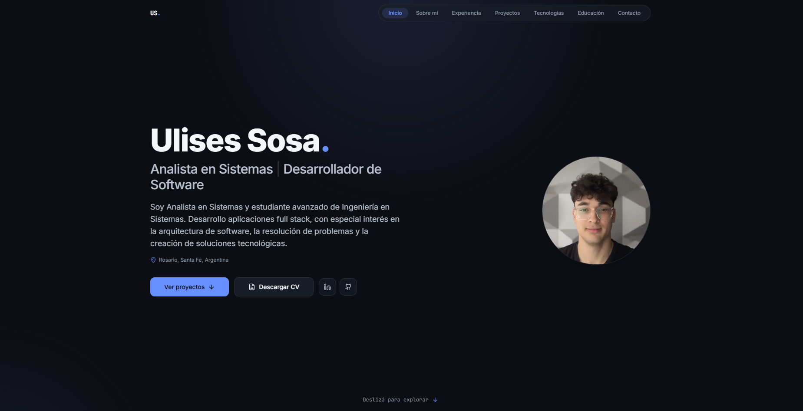

# Ulises Sosa — Developer Portfolio

Personal developer portfolio built with **Next.js**, **React**, and **TypeScript**, showcasing full-stack engineering projects, architectural case studies, and technical experience.

> **Live Portfolio → [portfolio-sosaulises.vercel.app](https://portfolio-sosaulises.vercel.app)**

---



---

## About the Project

This portfolio is designed to present my profile as a **Software Developer / Full Stack Developer** with equal emphasis on engineering rigor, clean code, and modern user experience. Rather than serving as a static résumé, it demonstrates hands-on frontend craftsmanship, accessible component architecture, and comprehensive technical documentation.

The project follows a **Dark Premium + Editorial Modern** design language:
- Restrained dark canvas (`#0B0F17`) with subtle ambient radial gradients.
- High-contrast typographic scale using `Inter` and `JetBrains Mono`.
- Purposeful, lightweight motion design that aids readability without decorative excess.
- Editorial layouts with distinct desktop and mobile compositions.

---

## Features

- **Responsive Editorial Design:** Two-column asymmetric desktop grid with sticky section markers and a centered mobile layout.
- **In-Depth Case Studies:** Dedicated pages for featured applications detailing architecture, data flow diagrams, technical challenges, and live demos.
- **Zero-Dependency Motion System:** Custom scroll reveal orchestrator leveraging `IntersectionObserver` and CSS keyframes, keeping sections as React Server Components.
- **Accessibility (a11y):** Full support for `prefers-reduced-motion: reduce`, visible keyboard focus indicators (`focus-visible`), and accessible dialog menus using `inert`.
- **Technical SEO & Social Previews:** Dynamic `robots.txt` and `sitemap.xml`, canonical URLs, and custom Open Graph / Twitter Card social previews for each project.
- **Optimized Asset Pipeline:** Modern WebP imagery, high-resolution SVG branding, and self-hosted Google Fonts with `display: swap`.
- **Interactive Contact:** One-click email copy with clipboard feedback and fallback, direct mailto action, and downloadable PDF résumé.

---

## Tech Stack

### Portfolio Application Stack
- **Framework:** [Next.js](https://nextjs.org/) 16 (App Router, Turbopack, React Server Components)
- **UI Library:** [React](https://react.dev/) 19
- **Language:** [TypeScript](https://www.typescriptlang.org/) 5.7
- **Styling:** [Tailwind CSS](https://tailwindcss.com/) 3.4
- **Icons & Primitives:** [Lucide React](https://lucide.dev/), [Radix UI](https://www.radix-ui.com/)
- **Animation Engine:** Native CSS Keyframes orchestrated via a single client-side `IntersectionObserver`
- **Hosting & CDN:** [Vercel](https://vercel.com/) (Edge Network)

> **Note:** The portfolio itself is built with Next.js and TypeScript. Technologies like ASP.NET Core, .NET 9, and PostgreSQL represent my backend and full-stack software development skillset and are highlighted within the project case studies below.

---

## Architecture & Project Structure

The project uses Next.js App Router with a modular separation between content data, reusable UI primitives, and feature-level presentation:

```text
portfolio/
├── app/                              # Next.js App Router
│   ├── layout.tsx                    # Root layout, fonts, and global metadata
│   ├── page.tsx                      # Home page (editorial single-page composition)
│   ├── robots.ts                     # Dynamic robots.txt generation
│   ├── sitemap.ts                    # Dynamic sitemap.xml generation
│   ├── globals.css                   # Tailwind tokens, keyframes & reduced-motion rules
│   └── proyectos/
│       └── [slug]/
│           └── page.tsx              # Dynamic SSG project case studies
├── components/
│   ├── portfolio/                    # Domain-specific portfolio sections
│   │   ├── hero.tsx                  # Hero presentation with responsive typography
│   │   ├── summary.tsx               # About Me editorial section
│   │   ├── experience.tsx            # Professional trajectory timeline
│   │   ├── projects.tsx              # Featured projects showcase
│   │   ├── tech-stack.tsx            # Categorized skills and tooling grid
│   │   ├── education.tsx             # Academic background with institutional branding
│   │   ├── contact.tsx               # Direct email action & clipboard integration
│   │   ├── navbar.tsx                # Sticky navigation with mobile sheet
│   │   ├── footer.tsx                # Minimal closing footer
│   │   └── project-detail/           # Interactive case study components
│   ├── ui/                           # Reusable UI primitives (buttons, badges, cards)
│   └── motion-reveal.tsx             # Client-side IntersectionObserver orchestrator
├── lib/
│   ├── projects.ts                   # Centralized project data, specs, and case studies
│   ├── experience.ts                 # Career experience data
│   ├── skills-data.ts                # Technical skill classifications
│   ├── motion.ts                     # Motion tokens and reveal helper attributes
│   └── utils.ts                      # Class variance and utility functions
├── hooks/
│   └── use-mobile.tsx                # SSR-safe breakpoint hook via useSyncExternalStore
├── public/                           # Static assets, WebP images, PDF CV, and favicons
└── docs/                             # Design brief and architectural documentation
```

### Architectural Highlights
- **Server Components by Default:** Sections remain Server Components; motion is applied via `data-reveal` attributes observed by a single zero-render component (`MotionReveal`).
- **Static Site Generation (SSG):** All 9 routes (including project dynamic routes via `generateStaticParams`) are prerendered statically at build time for near-instant edge delivery.
- **Strict Linting & Type Safety:** Verified with `npx tsc --noEmit` (0 errors) and ESLint Flat Config (`eslint.config.mjs`) compatible with React 19.

---

## Featured Case Studies

The portfolio features deep-dive technical case studies covering system design, domain modeling, and deployment strategies:

### 1. [Entrenate](https://portfolio-sosaulises.vercel.app/proyectos/entrenate) *(In Development)*
A personalized fitness web platform that adapts training plans to individual user goals, experience levels, and schedule availability.
- **Core Architecture:** Decoupled Next.js client communicating with an ASP.NET Core REST API.
- **Backend Patterns:** Clean Architecture, CQRS with MediatR, FluentValidation, and ASP.NET Core Identity with JWT.
- **Data & Cloud:** PostgreSQL (Neon), deployed across Vercel (Frontend) and Render (Backend).

### 2. [Blossom Institute](https://portfolio-sosaulises.vercel.app/proyectos/blossom-institute) *(In Development)*
An academic management platform engineered with multi-role access control for administrators, instructors, and students.
- **Core Architecture:** Clean Architecture with lightweight, decoupled CQRS (without MediatR overhead).
- **Backend Patterns:** Repository pattern, Entity Framework Core, structured error handling, and role-based authorization.
- **Tech Stack:** Next.js, TypeScript, ASP.NET Core (.NET 9), PostgreSQL.

### Additional Projects
- **[Sosa Gym API](https://portfolio-sosaulises.vercel.app/proyectos/gym-api):** High-performance RESTful API in .NET 8 featuring Clean Architecture, JWT authentication, and Swagger documentation.
- **[VetIng](https://portfolio-sosaulises.vercel.app/proyectos/veting):** Veterinary clinic management system built with ASP.NET Core MVC (Controller-Service-Repository) and payment gateway integration.

---

## Getting Started

### Prerequisites
- **Node.js:** `v18.18.0` or higher (Node 20+ recommended)
- **npm:** `v9.0.0` or higher

### Local Development Setup

```bash
# 1. Clone the repository
git clone https://github.com/SosaUlises/portfolio.git
cd portfolio

# 2. Install dependencies cleanly from lockfile
npm ci

# 3. Start the local development server
npm run dev
```

Open [http://localhost:3000](http://localhost:3000) in your browser to inspect the application.

### Available Scripts

| Command | Description |
| :--- | :--- |
| `npm run dev` | Starts the Next.js development server with Turbopack. |
| `npm run build` | Compiles and generates the optimized production static build. |
| `npm run start` | Starts the local production server to test the generated build. |
| `npm run lint` | Runs ESLint using Flat Config (`eslint.config.mjs`). |
| `npx tsc --noEmit` | Executes TypeScript typecheck with zero emit. |

---

## Accessibility & Performance

- **Motion Safety:** Automatically respects user operating system preferences (`prefers-reduced-motion: reduce`) by disabling transforms and transitions in `globals.css`.
- **Keyboard Navigation:** Explicit visible focus indicators on all interactive buttons, links, and tabs (`focus-visible:ring-2 focus-visible:ring-primary`).
- **Cumulative Layout Shift (CLS):** Explicit width and height definitions on all images and logos prevent layout shifting during page loading.
- **Font Delivery:** Google Fonts (`Inter` and `JetBrains Mono`) are downloaded at build time, self-hosted, and loaded with `display: swap` to prevent Flash of Invisible Text (FOIT).

---

## Deployment

The application is deployed on [Vercel](https://vercel.com/) with automated continuous delivery:
- Pushes to the production branch trigger automated static builds and immediate edge deployment.
- Pull Requests generate isolated **Preview Deployments**, allowing visual QA, responsive inspection, and metadata validation before merging to production.

---

## Contact & Links

- **Live Website:** [portfolio-sosaulises.vercel.app](https://portfolio-sosaulises.vercel.app)
- **GitHub:** [@SosaUlises](https://github.com/SosaUlises)
- **LinkedIn:** [/in/sosaulises](https://linkedin.com/in/sosaulises)
- **Email:** [sosaulisesp@gmail.com](mailto:sosaulisesp@gmail.com)

---

*Designed and developed by Ulises Sosa.*
